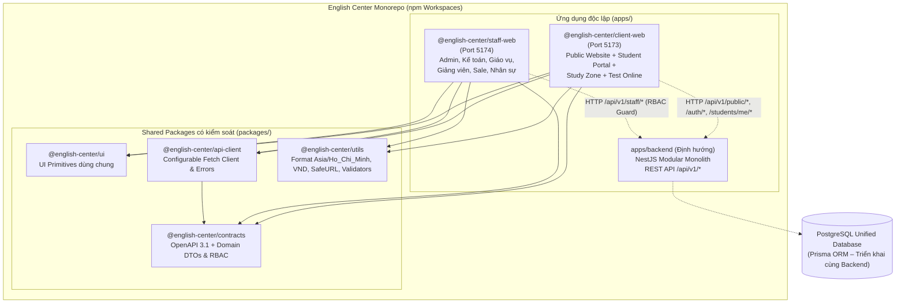

# KIẾN TRÚC TỔNG THỂ HỆ THỐNG – ENGLISH CENTER (`PROJECT_ARCHITECTURE`)

- **Hệ thống:** English Center
- **Mô hình kiến trúc:** **npm Workspaces Monorepo + 2 Frontend Độc Lập + 1 Backend Modular Monolith + 1 Cơ Sở Dữ Liệu Tập Trung**
- **Cập nhật lần cuối:** 25/11/2026

---

## 1. SƠ ĐỒ KIẾN TRÚC TỔNG THỂ

---

## 2. QUYẾT ĐỊNH KIẾN TRÚC CỐT LÕI

1. **Hai ứng dụng Frontend hoàn toàn độc lập (`client-web` & `staff-web`):**
   - **`apps/client-web` (Port `5173`):** Tối ưu SEO/UX, tốc độ tải trang, trải nghiệm đọc bài viết, Cổng học viên 5 tab và Phòng thi TOEIC trực tuyến toàn màn hình.
   - **`apps/staff-web` (Port `5174`):** Tối ưu vận hành nội bộ cho tất cả 6 nhóm nhân sự (`ADMIN`, `ACCOUNTANT`, `TEACHER`, `ACADEMIC`, `SALES`, `HR`) trên một ứng dụng quản trị duy nhất điều khiển bằng RBAC `module.action`.
   - **Cô lập trạng thái tuyệt đối:** Hai ứng dụng **không** chia sẻ `React Context`, **không** chia sẻ `QueryClient`, **không** dùng chung khóa `localStorage`/`sessionStorage` và có file `.env` riêng biệt.
2. **Một Backend Modular Monolith & Một Database duy nhất (`apps/backend`):**
   - Không tách hai Backend riêng cho Admin và Học viên; không dùng Microservices ở giai đoạn hiện tại; không tách hai Database gây lệch đồng bộ.
   - Hiện tại `apps/backend` chỉ chứa `README.md` định hướng, chưa có `package.json` và chưa tham gia npm Workspaces cho tới khi chính thức khởi tạo NestJS.
3. **Shared Packages tinh gọn, một chiều (Acyclic DAG):**
   - Chỉ đưa lên `packages/*` các thành phần thực sự dùng chung (`api-client`, `contracts`, `ui`, `utils`).
   - Duy trì **duy nhất 1 phiên bản `react@19.3.1`** được hoist tại root `node_modules`.
4. **Chuyển đổi Mock sang Backend API không viết lại UI:**
   - Mọi Page/Component chỉ giao tiếp qua Custom Hooks -> Feature API/Service/Repository -> `httpClient` (`@english-center/api-client`).
   - Chuyển từ Mock sang API thật thông qua biến môi trường của từng ứng dụng (`VITE_USE_MOCK_API=false` / `VITE_STAFF_USE_MOCK_API=false`).

---

## 3. PHIÊN BẢN CÔNG NGHỆ THỰC TẾ ĐANG SỬ DỤNG

| Thành phần | Gói / Công cụ | Phiên bản thực tế |
| --- | --- | --- |
| UI Library | `react`, `react-dom` | `19.3.1` |
| Ngôn ngữ | `typescript` | `7.0.2` (`~7.0.2`, `erasableSyntaxOnly: true`, `verbatimModuleSyntax: true`) |
| Bundler | `vite` (Rolldown), `@vitejs/plugin-react` | `8.3.8`, `6.3.0` |
| CSS Framework | `tailwindcss`, `@tailwindcss/vite` | `4.3.5` (khai báo `@source` quét `packages/ui/src`) |
| Routing | `react-router-dom` | `7.18.5` |
| Data Caching | `@tanstack/react-query` | `5.108.0` |
| Icons | `lucide-react` | `1.73.0` |
| Linter | `oxlint` | `1.94.0` |
| Package Manager | `npm Workspaces` | `lockfileVersion: 3` (1 `package-lock.json` duy nhất tại root) |
