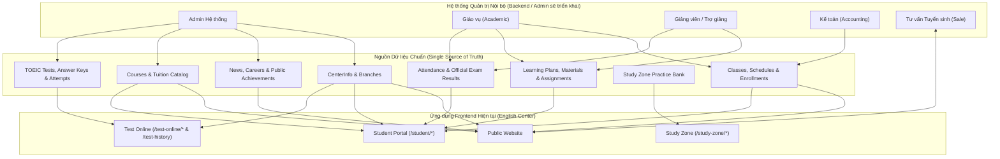
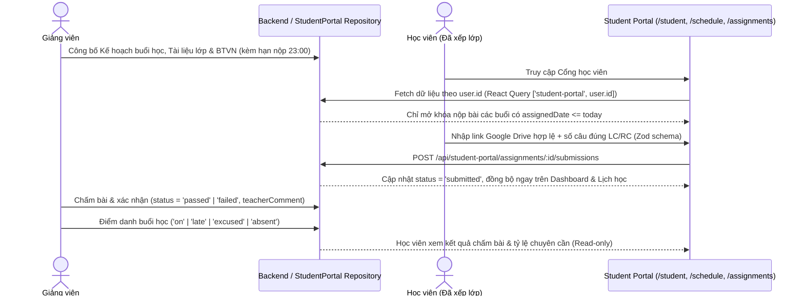
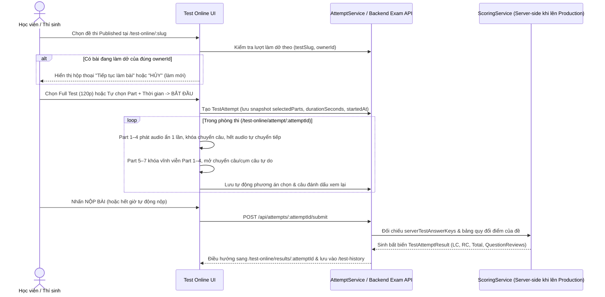

> **[CŨ – CẦN ĐỐI CHIẾU]** Tài liệu này thuộc giai đoạn Single-App trước khi tái cấu trúc Monorepo. Nội dung mới nhất đã được hợp nhất và thay thế bởi: `docs/data-model/DATA_FLOW.md`.

# SƠ ĐỒ LUỒNG DỮ LIỆU HỆ THỐNG (DATA FLOW MAP) – ENGLISH CENTER

Tài liệu này mô tả chi tiết luồng đi của dữ liệu giữa các tác nhân nghiệp vụ (**Admin, Giáo vụ, Giảng viên, Kế toán, Tư vấn tuyển sinh, Học viên, Khách truy cập**) và các phân khu Frontend (**Public Website, Student Portal, Study Zone, Test Online**), phục vụ trực tiếp cho việc xây dựng Backend Node.js & Database.

---

## 1. SƠ ĐỒ TỔNG THỂ LUỒNG DỮ LIỆU LIÊN PHÂN KHU



---

## 2. LUỒNG DỮ LIỆU CHI TIẾT THEO TỪNG NGHIỆP VỤ TRỌNG TÂM

### 2.1. Luồng Tư vấn Tuyển sinh -> Ghi danh -> Xếp lớp -> Học phí
```mermaid
sequenceDiagram
    actor Visitor as Khách / Học viên tiềm năng
    participant Web as Public Website (/courses, /schedule, /contact)
    participant API as Backend API / Lead Store
    actor Sale as Tư vấn viên
    actorKT as Kế toán
    actor Academic as Giáo vụ
    participant Portal as Student Portal (/student/*)

    Visitor->>Web: Xem Khóa học & Lịch khai giảng (chỉ lớp status != cancelled)
    Visitor->>Web: Gửi Form Nhận Tư Vấn (Họ tên, SĐT, Cơ sở, Khóa/Lộ trình)
    Web->>API: POST /api/consultations (Validate SĐT VN, lưu Lead)
    API-->>Sale: Tạo hồ sơ tư vấn & kiểm tra đầu vào (Entry Score)
    Sale->>actorKT: Chuyển thông tin đăng ký khóa học
    actorKT->>API: Xác nhận thu học phí (chốt snapshot agreedTuitionVnd)
    Academic->>API: Tạo Enrollment gắn Student -> Class (cls-ec-s01)
    Visitor->>Portal: Đăng nhập tài khoản Học viên
    Portal->>API: GET /api/student-portal/me
    API-->>Portal: Trả về ClassInfo, Kế hoạch 24 buổi, Thời khóa biểu & Bài tập
```

### 2.2. Luồng Học tập trên lớp: Kế hoạch học tập -> Bài tập -> Nộp bài -> Chấm bài & Điểm danh


### 2.3. Luồng Thi trực tuyến TOEIC (`Test Online`) & Bảo toàn lịch sử (`Snapshot`)


---

## 3. RANH GIỚI TRÁCH NHIỆM DỮ LIỆU TRÊN FRONTEND

1. **Tầng Component / Page (`src/features/*/pages`, `components`):**
   - Chỉ nhận dữ liệu đã chuẩn hóa từ Custom Hooks (`useStudentPortalData`, `useTests`, `useAttemptSession`, `useSchedules`, `useAuth`), hiển thị trạng thái `loading` / `error` / `empty` và gửi sự kiện thao tác của người dùng.
   - Không truy cập trực tiếp `localStorage` trong JSX.
2. **Tầng Hook & Query (`src/features/*/hooks`):**
   - Quản lý vòng đời bất đồng bộ, phân tách cache theo `user.id` và vô hiệu hóa cache khi dữ liệu thay đổi.
3. **Tầng API / Repository / Service (`src/features/*/api`, `services`, `repositories`):**
   - Kiểm tra cờ `USE_MOCK_API` tại `src/services/api/apiConfig.ts`:
     - Khi `VITE_USE_MOCK_API !== 'false'` (mặc định giai đoạn hiện tại): Đọc/ghi qua Mock Data chuẩn hóa & `localStorage` có phân lập `ownerId`.
     - Khi `VITE_USE_MOCK_API === 'false'` (khi kết nối Backend Node.js): Gọi thẳng `httpClient` (`axios`) tới các hằng số `API_ENDPOINTS` mà **không cần sửa bất kỳ Component giao diện nào**.
