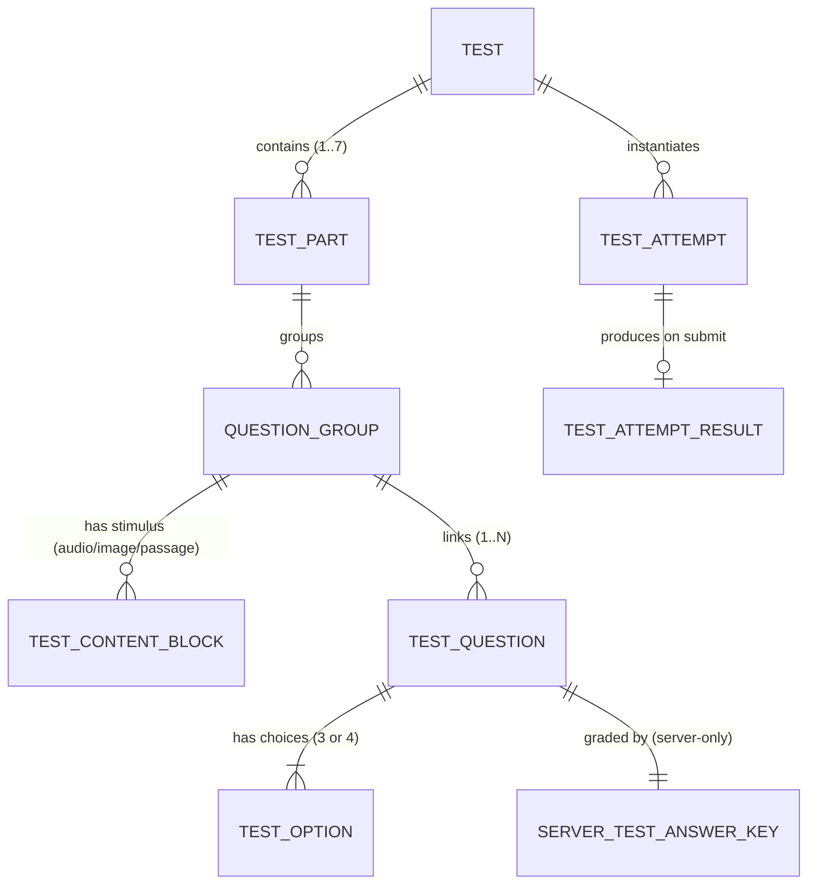

# BÁO CÁO KIỂM ĐỊNH CẤU TRÚC DỮ LIỆU & QUAN HỆ THỰC THỂ (TOEIC TEST DATA AUDIT)

- **Dự án**: ENGLISH CENTER – Client Web Frontend
- **Tệp trọng tâm**: `src/features/test-online/types/test.types.ts`, `mocks/testMockData.ts`, `services/attemptService.ts`, `services/scoringService.ts`, `src/services/api/endpoints.ts`
- **Ngày kiểm định**: 24/11/2026

---

## 1. Bảng đối chiếu 13 thực thể dữ liệu cốt lõi (Phần 7)

| STT | Thực thể yêu cầu | Thực thể / Kiểu trong code | Trạng thái | Đánh giá thiết kế & khóa liên kết |
|---|---|---|---|---|
| 1 | **Test** (Thông tin đề thi) | `interface Test` | **PASS** | Có `id`, `code`, `slug`, `title`, `collectionGroup`, `skillCategory`, `difficulty`, `testType`, `duration`, `totalQuestions`, `standardTotalQuestions`, `status`, `parts`, `scoreConversionTable`. |
| 2 | **Test Version** (Phiên bản đề) | *(Chưa có)* | **MISSING** | Thiếu trường `version` / `testVersionId` để đóng băng nội dung đề tại thời điểm học viên làm bài. |
| 3 | **Section** (Listening / Reading) | `type ToeicSectionType = 'listening' \| 'reading'` | **PARTIAL** | Hiện mới là thuộc tính `section` gắn trên từng `TestPart`, chưa tách thành thực thể cấu hình riêng (ví dụ: `listeningDurationMinutes: 45`, `readingDurationMinutes: 75`, `lockBackwardNavigation: true`). |
| 4 | **Part** (Part 1 – Part 7) | `interface TestPart` | **PASS** | Có `id` riêng, `partNumber` (`1..7`), `section`, `title`, `instructions`, `importantNotes`, `introductionBlocks`, `questionCount`, `standardToeicCount`, `allowStandaloneSelection`, `questionGroups`. |
| 5 | **Passage** (Đoạn văn / Đa văn bản) | `TestContentBlock` (`type: 'text'`, `variant: 'passage'`) trong `QuestionGroup.stimulus` | **PASS** | Mỗi đoạn văn là 1 phần tử có `id` riêng trong mảng `stimulus: TestContentBlock[]`, cho phép 1 nhóm câu hỏi chứa 1, 2 hoặc 3 đoạn văn liên tiếp theo đúng thứ tự. |
| 6 | **Question Group** (Nhóm câu hỏi) | `interface QuestionGroup` | **PASS** | Có `id`, `partNumber`, `groupTitle`, `audioGroupId`, `stimulus[]`, `questions[]`, `displayOrder`. Giải quyết đúng bài toán 1 audio / 1 cụm văn bản dùng chung cho nhiều câu hỏi. |
| 7 | **Question** (Câu hỏi) | `interface TestQuestion` | **PASS** | Có `id`, `questionNumber`, `partNumber`, `groupId` (khóa ngoại trỏ ngược về `QuestionGroup`), `content[]`, `options[]`, `displayOrder`. **Không chứa đáp án đúng.** |
| 8 | **Option** (Phương án trả lời) | `interface TestOption` | **PASS** | Có `id` riêng (`t01-q1-a`...), `label` (`'A' \| 'B' \| 'C' \| 'D'`), `content: TestContentBlock[]` (hỗ trợ cả phương án chữ lẫn phương án hình ảnh). Tuy nhiên kiểu `label` đang giới hạn tối đa A–D (đủ cho TOEIC L&R). |
| 9 | **Media** (Hình ảnh & Audio) | `TestContentBlock` (`type: 'image' \| 'audio'`) | **PARTIAL** | Có `id`, `url`, `alt`/`caption` hoặc `title`/`durationSeconds`. Chưa có metadata quản trị tệp độc lập (`mimeType`, `fileSize`, `checksum`, `storageKey`) phục vụ CMS Admin sau này. |
| 10 | **Answer Key** (Đáp án đúng & Giải thích) | `interface ServerTestAnswerKey` | **PASS (Kiểu)** / **PARTIAL (Lưu trữ)** | Tách rời hoàn toàn khỏi `TestQuestion` thông qua khóa `questionId` (`correctOptionId`, `explanation`, `transcript`, `translation`). Hiện đặt trong `testMockData.ts` phục vụ Mock; khi có Backend chỉ lưu trên Server. |
| 11 | **Test Attempt** (Lượt làm bài) | `interface TestAttempt` | **PASS** | Mỗi lần làm bài sinh `id` mới (`ATT-YYYYMMDD-XXX`), lưu `studentId`, `testId`, `practiceMode`, `selectedParts`, `startedAt`, `deadlineAt`, `timerPausedAt`, `submittedAt`, `status`, `audioStates`, `introducedParts`, `currentPartNumber`, `currentStage`. |
| 12 | **Student Answer** (Đáp án học viên chọn) | `answers: Record<string, string>` trong `TestAttempt` | **PARTIAL** | Lưu gọn nhẹ dạng map `questionId -> selectedOptionId`, tránh trùng lặp đáp án cho cùng 1 câu. Khi chuyển sang Database quan hệ nên chuẩn hóa thành bảng `test_attempt_answers(attempt_id, question_id, selected_option_id, answered_at)`. |
| 13 | **Test Result** (Kết quả chấm điểm) | `interface TestAttemptResult` & `PartPerformanceStat` & `QuestionReviewDetail` | **PASS** | Lưu đầy đủ điểm quy đổi (`convertedListeningScore`, `convertedReadingScore`, `convertedTotalScore`), số câu đúng/sai/bỏ trống, thời gian thực làm (`actualDurationSeconds`), thống kê từng Part và map `reviews` theo `questionId`. |

---

## 2. Sơ đồ quan hệ dữ liệu hiện tại (ER Diagram)

---

## 3. Kiểm tra tính toàn vẹn dữ liệu & API Contract

1. **Tính duy nhất của ID trong Mock Data (`CẢNH BÁO QUAN TRỌNG – P2`)**:
   - Trong `testMockData.ts` (dòng 1136–1256), các đề `TEST 5 – 2026` đến `TEST 10 – 2026` và `TEST 1 – 2025`, `TEST 2 – 2025` đang tái sử dụng tiền tố `'t01'..'t06'` trong `buildStandardParts('t01', true)`.
   - Hệ quả: `question.id` (ví dụ `t01-q1`) trùng nhau giữa `TEST 1 – 2026` và `TEST 5 – 2026`. Mặc dù không gây lỗi khi làm từng lượt thi riêng lẻ (vì `attempt.answers` cô lập theo `attempt.id`), nhưng về chuẩn cơ sở dữ liệu, mỗi đề phải truyền `testPrefix` riêng biệt (`t05`, `t06`, `t07`, `t08`, `t09`, `t10`, `t25_01`, `t25_02`) để `part.id`, `group.id`, `question.id` và `option.id` là duy nhất toàn cục.
2. **Tối ưu dung lượng LocalStorage (`PASS`)**:
   - `attemptService.ts` đã chủ động không lưu chuỗi base64 WAV dài vào `audioStates[groupId].audioUrl` trong `localStorage` và có bộ nhớ dự phòng `memoryAttemptsFallback` / `memoryResultsFallback` chống lỗi `QuotaExceededError`.
3. **Đánh giá REST API Endpoints dự kiến (`src/services/api/endpoints.ts`)**:
   - Đã định nghĩa đầy đủ 8 endpoint học viên dưới `/public/tests`, `/public/test-attempts/*`, `/public/test-history/*`.
   - **Đề xuất chuẩn hóa khi ghép Backend**: Các endpoint thao tác phiên thi cá nhân (`startAttempt`, `saveProgress`, `submitAttempt`, `attemptResult`, `historyList`, `historyDetail`) nên chuyển từ tiền tố `/public/...` sang `/student/test-attempts/...` hoặc yêu cầu Bearer Token bắt buộc để tránh nhầm lẫn là API không cần xác thực.
