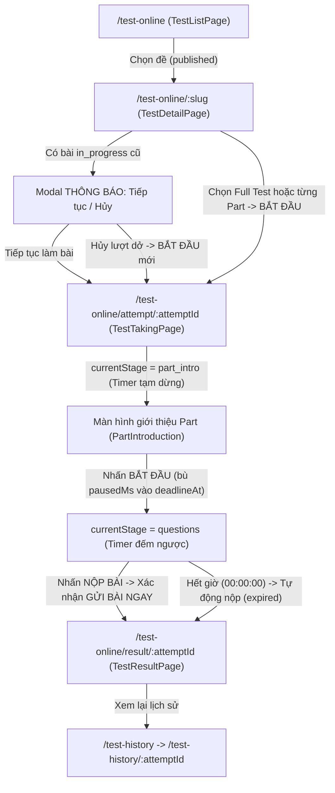

# BÁO CÁO KIỂM ĐỊNH QUY TRÌNH LÀM BÀI (TOEIC TEST FLOW AUDIT)

- **Dự án**: ENGLISH CENTER – Client Web Frontend
- **Phân hệ kiểm tra**: Luồng nghiệp vụ học viên từ Danh sách đề thi → Chuẩn bị thi → Phòng thi → Nộp bài → Kết quả & Lịch sử
- **Ngày kiểm định**: 24/11/2026

---

## 1. Sơ đồ luồng làm bài hiện tại trong mã nguồn

---

## 2. Đánh giá chi tiết từng bước trong quy trình (Phần 3 & Phần 5)

### 3.1. Danh sách đề thi (`TestListPage.tsx`, `TestCard.tsx`, `testApi.ts`)

| Tiêu chí | Trạng thái | Chi tiết đối chiếu mã nguồn |
|---|---|---|
| Chỉ hiển thị đề đã xuất bản (`published`) | **PASS** | `testApi.getTests()` lọc `t.status === 'published'`. Đề `draft` hoặc `hidden` không xuất hiện. |
| Xem tên đề, nhóm bộ đề, lượt hoàn thành, phân loại kỹ năng | **PASS** | Hiển thị rõ tên đề (`TEST 1 – 2026`), nhóm bộ đề (`2026 (New)`, `2025 Core Collection`), số lượt hoàn thành và tab kỹ năng. |
| Xem mã đề, tổng số câu, thời gian, trạng thái cá nhân ngay trên thẻ danh sách | **PARTIAL** | Để tối giản giao diện theo mẫu thẻ gọn 4 cột (`TEST 1 – 2026 →` + lượt hoàn thành), các trường `code`, `duration`, `standardTotalQuestions` có trong dữ liệu `Test` nhưng chỉ hiển thị khi bấm vào trang chi tiết `TestDetailPage`. |
| Giới hạn số lượt thi tối đa của học viên (`maxAttempts`) | **MISSING** | Chưa có thuộc tính `maxAttempts` trên `Test` và chưa kiểm tra giới hạn lượt thi. |

---

### 3.2. Trang giới thiệu & thiết lập trước khi thi (`TestDetailPage.tsx`)

| Tiêu chí | Trạng thái | Chi tiết đối chiếu mã nguồn |
|---|---|---|
| Hiển thị tên đề, thời gian, cấu trúc Listening & Reading (Part 1–7, số câu) | **PASS** | Hiển thị `test.title`, thời gian làm bài (`2 giờ` hoặc số phút tùy chọn), bảng `LISTENING` (Part 1–4) và `READING` (Part 5–7), lưu ý trình duyệt Chrome và nút `BẮT ĐẦU`. |
| Hiển thị loại bài thi, mã đề và danh sách lưu ý chi tiết (`generalInstructions`) | **PARTIAL** | Có lưu ý trình duyệt Chrome và thanh hotline hỗ trợ, nhưng mảng `test.generalInstructions` và `test.code` chưa được render ra giao diện `TestDetailPage`. |
| **Không tự động tính giờ** khi mới mở trang giới thiệu đề | **PASS** | Mở `/test-online/:slug` hoàn toàn không tạo `TestAttempt` và không chạy timer. Ngay cả sau khi bấm `BẮT ĐẦU` vào màn hình `PartIntroduction` đầu tiên, `timerPausedAt` giữ đồng hồ đứng yên ở `02:00:00` cho tới khi học viên bấm bắt đầu vào câu hỏi (`confirmPartIntroduction`). |
| Phát hiện bài thi đang làm dở (`in_progress`) | **PASS** | `findInProgressAttemptByTestSlug` kiểm tra lượt thi chưa nộp và hiển thị hộp thoại `THÔNG BÁO` cho phép `Tiếp tục làm bài` hoặc `HỦY` để tạo lượt mới. |
| Ràng buộc `allowStandaloneSelection` khi chọn từng Part | **FAIL** | Trong `testMockData.ts` (`TEST 2 – 2025`), Part 3 & 4 có `allowStandaloneSelection: false`, nhưng `handleTogglePart` trong `TestDetailPage.tsx` (dòng 72–89) chưa kiểm tra cờ `partObj.allowStandaloneSelection` và `test.allowPartSelection`. |

---

### 3.3 & 3.4. Giao diện làm bài Listening & Reading (`TestTakingPage.tsx`, `TestQuestionRenderer.tsx`)

| Tiêu chí | Trạng thái | Chi tiết đối chiếu mã nguồn |
|---|---|---|
| Hình ảnh, văn bản đoạn đọc, câu hỏi, đáp án A–D, đánh dấu câu (`Bookmark`) | **PASS** | Hiển thị rõ ràng 2 cột khi có stimulus; cột đọc bên trái `sticky` có cuộn riêng không làm trôi câu hỏi; nút `Đánh dấu` hoạt động tức thì; không bị nhảy lên đầu trang khi chọn đáp án câu 2, 3 trong cùng nhóm. |
| Đồng hồ đếm ngược, tiến độ `answeredCount/totalQuestions`, ngăn danh sách câu hỏi | **PASS** | Topbar cố định hiển thị `NỘP BÀI`, `TestTimer`, tên học viên; ô tiến độ cam `0/18` và ngăn kéo trượt bên trái hiển thị rõ câu đang đứng (cam), câu đã làm (xanh `#75BDEB`), câu chưa làm (xám) và chấm vàng đánh dấu. |
| Trình phát âm thanh trong phòng thi Listening | **FAIL** | Trong `src/features/test-online/components/AudioPlayer.tsx`, điều kiện `if (mode !== 'review') return null` và bộ lọc `visibleStimulus` trong `TestQuestionRenderer.tsx` đã tắt hẳn thẻ `<audio>` khi `mode === 'exam'`. Học viên không nhìn thấy thanh tua nhưng cũng **không nghe thấy âm thanh đề thi**. |
| Không bị che khuất nội dung bởi thanh cố định | **PASS** | Topbar dùng `sticky top-0` và container trang có `pb-16` tránh thanh hotline `fixed bottom-0`. |

---

### 3.5. Quy trình chuyển từ Listening sang Reading (Quy định đặc thù của English Center)

| Quy định bắt buộc của English Center | Trạng thái hiện tại | Phân tích nguyên nhân trong code |
|---|---|---|
| 1. Học viên thực hiện Listening trước | **PARTIAL** | Mặc định mở Part nhỏ nhất đã chọn (Part 1), nhưng học viên hiện có thể bấm `P5`, `P6`, `P7` hoặc mở ngăn câu hỏi nhảy thẳng sang Reading. |
| 2. Audio Listening chỉ phát 1 lần theo `audioGroupId` | **FAIL** | Logic `AudioGroupState` (`NOT_PLAYED` -> `PLAYING` -> `LOCKED`) vẫn còn trong `test.types.ts`, nhưng `attemptService.ts` đang gán sẵn `status: 'LOCKED'` và `TestAudioPlayer` trả về `null` ở chế độ `exam`. |
| 3. Không cho tua lại hoặc phát lại audio đã hoàn thành | **PARTIAL** | Học viên không thể tua hoặc phát lại vì UI audio đã bị ẩn, nhưng bản thân lượt phát 1 lần chưa hoạt động. |
| 4. Hoàn thành Listening / hết giờ Listening tự động chuyển sang Reading | **FAIL** | Chưa có đồng hồ 45 phút riêng cho Listening; hàm `handleAudioPlayCompleted` trong `TestTakingPage.tsx` không còn được gọi do `<audio>` không được mount ở chế độ thi. |
| 5. Sau khi chuyển sang Reading, **không được quay lại Listening** | **FAIL** | Trong `TestTakingPage.tsx` (`canGoPrevStep`, thanh nút `P1..P7`) và `QuestionNavigator.tsx`, khóa chặn quay lại Listening và khóa mở sớm Reading đã bị gỡ bỏ (`listeningCompleted` luôn bằng `true`). Học viên đang có thể quay lại Part 1–4 chỉnh sửa đáp án. |
| 6. Di chuyển tự do giữa các câu Reading trong thời gian còn lại | **PASS** | Chuyển câu `CÂU TRƯỚC` / `CÂU TIẾP`, bấm `P5..P7` và nhảy câu bất kỳ qua `QuestionNavigator` hoạt động mượt. |
| 7. Lưu đáp án trước khi chuyển phần & giữ trạng thái khi F5 tải lại trang | **PASS (Mock)** | Mỗi lần chọn đáp án hoặc chuyển bước đều ghi ngay vào `localStorage` (`attemptApi.saveAttemptProgress`). Khi F5, đồng hồ `deadlineAt`, đáp án đã chọn và vị trí câu đang đứng được khôi phục nguyên vẹn. *(Lưu ý: Cần đồng bộ lên Backend khi triển khai thật vì `localStorage` có thể bị người dùng xóa thủ công).* |

---

### 3.6. Quy trình Nộp bài, Chấm điểm & Xem kết quả (Phần 5)

| Tiêu chí | Trạng thái | Chi tiết đối chiếu mã nguồn |
|---|---|---|
| Nút nộp bài, hộp thoại xác nhận & cảnh báo số câu đã hoàn thành | **PASS** | `TestSubmitModal.tsx` hiển thị `Bạn đã hoàn thành X/N câu hỏi`, hỗ trợ đóng bằng phím `Escape` hoặc nút `ĐÓNG`, khóa nút khi `submitting = true`. |
| Tự động thu bài khi hết giờ (`00:00:00`) | **PASS** | `useTestTimer` gọi `handleAutoExpire` đúng 1 lần (`expiredCalledRef`), chuyển trạng thái thành `'expired'` và điều hướng sang trang kết quả. |
| Chống gửi trùng yêu cầu nộp bài & khóa sửa đáp án sau khi nộp | **PASS** | Cờ `submitting` trên UI kết hợp kiểm tra `if (attempt.status !== 'in_progress' && existingResults[attemptId]) return existingResults[attemptId]` trong `attemptService.finalizeAttempt` và tự động redirect khỏi phòng thi nếu `status !== 'in_progress'`. |
| Chấm điểm đúng / sai / bỏ trống & quy đổi theo bảng điểm | **PARTIAL** | `scoringService.ts` phân biệt chính xác câu đúng, câu sai, câu bỏ trống; tính riêng `convertedListeningScore` và `convertedReadingScore` bằng bảng tra cứu `ScoreConversionPoint[]` (không nhân hệ số cố định). Tuy nhiên bảng quy đổi mẫu mới chỉ có 9 mốc tỷ lệ (`minRatio`) thay vì bảng 101 mốc chuẩn từ 0–100 câu đúng. |
| Trang kết quả hiển thị đầy đủ chỉ số & kiểm soát quyền xem đáp án | **PARTIAL** | `TestResultSummary.tsx` hiển thị Tên đề, Tổng điểm `/990`, Thời gian làm, Bắt đầu, Hoàn thành và Số câu đúng từng Part; **còn thiếu hiển thị Điểm Listening `/495`, Điểm Reading `/495`, Số câu sai và Số câu bỏ trống** trên thẻ tổng hợp (dù `result` đã tính sẵn). Ngoài ra chưa có cờ cấu hình ẩn/hiện đáp án chi tiết theo từng đề thi (`allowReview`). |
