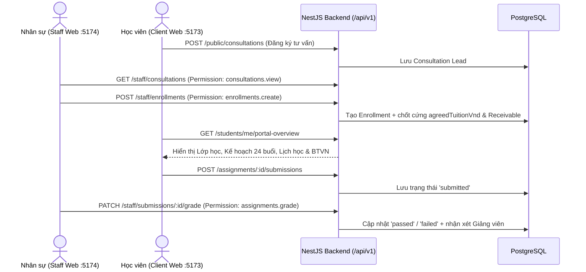

# LUỒNG DỮ LIỆU KIẾN TRÚC FRONTEND – BACKEND (`DATA_FLOW`)

Tài liệu này mô tả luồng đi của dữ liệu trong nội bộ từng ứng dụng Frontend và giữa hai ứng dụng (`client-web`, `staff-web`) với Backend Node.js tập trung.

---

## 1. LUỒNG TRUY CẬP DỮ LIỆU CHUẨN TRONG MỖI FRONTEND

```text
PAGE / UI COMPONENT (Không import trực tiếp Mock Data, không gọi thẳng fetch)
        │
        ▼
CUSTOM HOOK (TanStack Query: CLIENT_QUERY_KEYS / staffQueryClient)
        │
        ▼
FEATURE API / SERVICE / REPOSITORY (Kiểm tra cờ USE_MOCK_API / USE_STAFF_MOCK_API)
        ├── [Mock Mode]  ──▶ Nạp động Mock Data (async chunk) / Session & Local Storage có kiểm soát
        └── [API Mode]   ──▶ httpClient / staffHttpClient (@english-center/api-client)
                                    │
                                    ▼
                        BACKEND NODE.JS (NestJS /api/v1/*)
                                    │
                                    ▼
                        POSTGRESQL UNIFIED DATABASE
```

---

## 2. GIỚI HẠN CỦA MOCK DATA & QUY TẮC ĐỒNG BỘ THỰC TẾ

1. **Không đồng bộ giả giữa hai ứng dụng ở chế độ Mock:**
   - `apps/client-web` (port `5173`) và `apps/staff-web` (port `5174`) chạy trên hai origin độc lập của trình duyệt.
   - Dữ liệu Mock trong bộ nhớ hoặc `localStorage`/`sessionStorage` của `staff-web` **không** tự động truyền sang `client-web` và hệ thống **không** xây dựng cơ chế đồng bộ giả phức tạp giữa hai cổng Mock.
2. **Đồng bộ thực tế thông qua Backend & Database duy nhất:**
   - Khi kết nối Backend NestJS (`VITE_USE_MOCK_API=false` & `VITE_STAFF_USE_MOCK_API=false`), mọi thay đổi được phép xuất bản từ `staff-web` (ví dụ Giáo vụ xếp lớp, Giảng viên chấm BTVN/điểm danh, Admin xuất bản khóa học/đề thi mới) được ghi vào **PostgreSQL** và phản ánh ngay lập tức trên `client-web` qua các API `/api/v1/*`.

---

## 3. SƠ ĐỒ TƯƠNG TÁC NGHIỆP VỤ XUYÊN HỆ THỐNG (KHI CÓ BACKEND)


