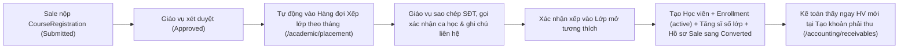

# QUY TRÌNH NGHIỆP VỤ PHÂN HỆ GIÁO VỤ (`ACADEMIC_WORKFLOW`)

## 1. Luồng Liên thông Sales CRM → Xếp lớp theo tháng → Kế toán

## 2. Luồng Chuyển lớp Bảo toàn Lịch sử (6 Bước)

1. Chọn học viên đang học (`active`) trong danh sách lớp hiện tại.
2. Giữ nguyên thông tin lớp hiện tại để lưu lịch sử.
3. Chọn lớp đích còn chỗ trống (`remainingSeats > 0`, chưa kết thúc/hủy).
4. Kiểm tra tự động xung đột lịch học (`checkClassScheduleConflict`) với các lớp khác đang học.
5. Nhập lý do chuyển lớp bắt buộc.
6. Xác nhận: đánh dấu bản ghi `Enrollment` cũ sang `'transferred'` kèm `endedAt`, tạo `Enrollment` mới `'active'` ở lớp đích, lưu `ClassTransferHistoryDto`, điều chỉnh sĩ số hai lớp.

## 3. Luồng Bảo lưu / Chuyển lớp / Học lại

- Máy trạng thái: `Pending` → `Reviewing` → `Approved` / `Rejected` / `Cancelled` → `Completed`.
- Duyệt **Bảo lưu (`hold`)**: chuyển `learningStatus` của học viên và `Enrollment` hiện hành sang `'hold'`.
- Hoàn tất **Chuyển lớp (`transfer`)**: kích hoạt luồng chuyển lớp chuẩn có lưu lịch sử.
- Hoàn tất **Học lại (`retake`)**: tạo bản ghi `Enrollment` mới ở lớp học lại mà không xóa lịch sử khóa cũ đã `completed`.

## 4. Luồng Duyệt Nguyện vọng Dạy lớp của Giảng viên

- Giảng viên gửi yêu cầu `Requested` trên lớp chưa có GV.
- Giáo vụ mở tab **Duyệt nguyện vọng dạy lớp** tại `/academic/classes`, hệ thống kiểm tra lại trùng lịch giảng viên và khi bấm `Duyệt dạy`, lớp được gán chính thức `teacherId` + `teacherName`.
