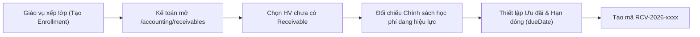

# QUY TRÌNH NGHIỆP VỤ PHÂN HỆ KẾ TOÁN (`ACCOUNTING_WORKFLOW`)

## 1. Luồng Khởi tạo Khoản phải thu (`Receivable`)

- Mỗi `Enrollment` hợp lệ chỉ có tối đa **01** khoản phải thu đang hiệu lực (chưa hủy).
- Trạng thái khoản phải thu được suy diễn tự động theo thứ tự ưu tiên:
  `Cancelled` > `Paid` > `Overdue` (`remainingVnd > 0` và `dueDate < todayYmdVn`) > `PartiallyPaid` > `Unpaid`.

## 2. Luồng Thu Học phí Từng đợt (`Cash` & `Manual Bank Transfer`)

1. Kế toán chọn khoản phải thu tại `/accounting/payments`.
2. Hệ thống tự động tính `Số tiền còn được thu tối đa = Tổng phải thu - Đã thu xác nhận - Đang chờ kiểm tra sao kê`.
3. Chặn hoàn toàn:
   - Số tiền `<= 0`.
   - Số tiền vượt quá số dư còn được phép thu.
   - Mã tham chiếu chuyển khoản trùng lặp với giao dịch hợp lệ trước đó.
4. Nếu thu **Tiền mặt (`cash`)**: chuyển thẳng sang `Confirmed`.
5. Nếu thu **Chuyển khoản (`bank_transfer`)**: Kế toán có thể lưu `PendingVerification` (chờ kiểm tra sao kê) hoặc xác nhận ngay nếu đã kiểm tra chứng từ.

## 3. Luồng Xuất Phiếu thu (`Receipt`)

- Chỉ các giao dịch có `status === 'Confirmed'` mới được phép lập Phiếu thu (`PT-2026-xxxx`).
- Hỗ trợ xem chi tiết chứng từ chuẩn nội bộ và in trực tiếp qua `window.print()`.

## 4. Luồng Hoàn tiền (`Refund`) & Hủy nghiệp vụ (`Void`)

- **Hoàn tiền**: `PendingApproval` → `Approved` / `Rejected` → `Completed` / `Cancelled`. Kiểm tra trần hoàn tiền `<= Số tiền giao dịch gốc - Tổng các yêu cầu hoàn trước đó của giao dịch đó`.
- **Hủy giao dịch sai (`Void`)**: Yêu cầu bắt buộc nhập lý do, ghi vào `TransactionAuditLogDto`, chặn hủy nếu giao dịch đang gắn với hồ sơ hoàn tiền hiệu lực.
