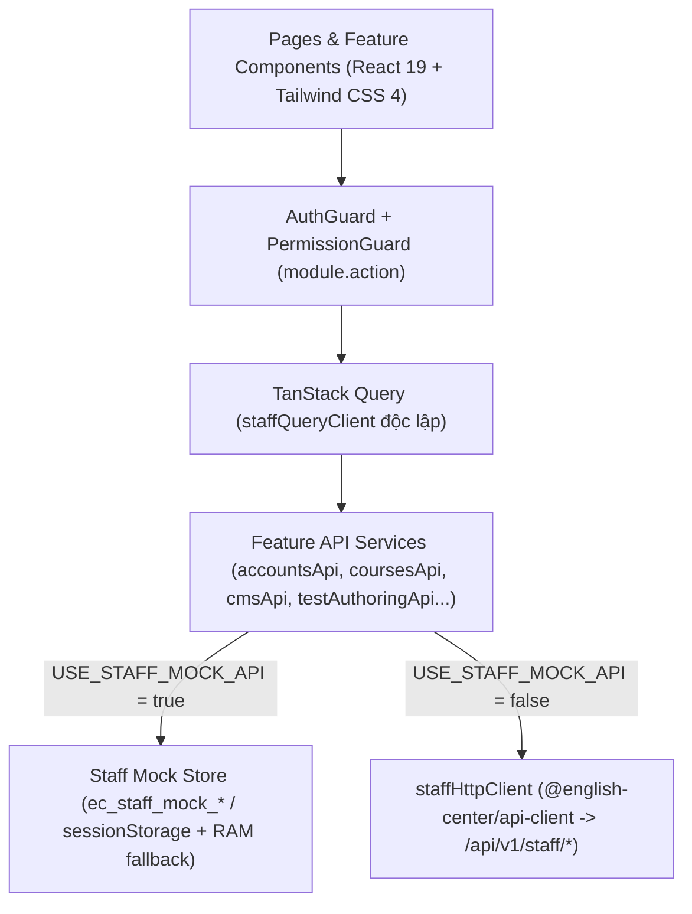

# KIẾN TRÚC ỨNG DỤNG QUẢN TRỊ – `apps/staff-web` (`STAFF_ARCHITECTURE`)

- **Workspace package:** `@english-center/staff-web`
- **Cổng phát triển:** `http://localhost:5174` (`strictPort: true`)
- **Cổng preview:** `http://localhost:4174` (`strictPort: true`)
- **Thương hiệu thống nhất:** **English Center – Admin & Staff Portal**

---

## 1. TỔNG QUAN KIẾN TRÚC PHÂN LỚP

`apps/staff-web` hoạt động độc lập hoàn toàn với `apps/client-web` (`:5173`), nhưng chia sẻ hợp đồng kiểu dữ liệu, bộ công cụ chuẩn hóa và UI primitives thông qua 4 gói nội bộ `@english-center/*`.



### Nguyên tắc cốt lõi
1. **Không gọi `fetch` trực tiếp trong Page/Component:** Mọi truy vấn đi qua `TanStack Query` -> `*Api.ts` -> nhánh `Mock Adapter` hoặc `staffHttpClient`.
2. **Cô lập tuyệt đối với Client Web:**
   - Khóa lưu trữ phiên đăng nhập riêng: `ec_staff_auth_session_v1`.
   - Khóa Mock Store riêng: `ec_staff_mock_*`.
   - `staffQueryClient` tách rời, tự động xóa sạch cache khi `logout()` hoặc gặp lỗi `401 Unauthorized`.
3. **Không cài thêm thư viện ngoài:**
   - Biểu đồ thống kê: Xây dựng bằng `<svg>` thuần có `<title>` hỗ trợ tiếp cận tại [`SvgCharts.tsx`](file:///d:/Web/english-center-mini/apps/staff-web/src/shared/components/SvgCharts.tsx).
   - Soạn thảo bài viết CMS: Trình biên tập khối có cấu trúc (`heading`, `paragraph`, `list`, `image`, `link` kiểm tra qua `toSafeHttpUrl`), tuyệt đối không dùng `dangerouslySetInnerHTML`.
   - Sắp xếp thứ tự khối/nhóm/câu hỏi: Điều khiển trực quan bằng nút `↑` / `↓`.

---

## 2. CẤU TRÚC THƯ MỤC `apps/staff-web/src/`

```text
apps/staff-web/src/
├── app/
│   ├── guards/             # AuthGuard.tsx, PermissionGuard.tsx
│   ├── providers/          # AppProviders.tsx (QueryClient + ToastProvider + StaffAuthProvider)
│   └── router/             # index.tsx (18 route quản trị + /login + /403 + /404)
├── components/             # StaffSystemPages.tsx (403, 404, RouteErrorBoundary)
├── config/                 # center.config.ts (English Center + '[Chưa cập nhật]')
├── features/
│   ├── auth/               # Đăng nhập nhân sự, khôi phục phiên, nạp quyền động theo Role
│   ├── dashboard/          # KPI tổng hợp + Biểu đồ SVG tuyển sinh, doanh thu, khóa học
│   ├── accounts/           # AccountsPage (/accounts) + RolesPage (/roles)
│   ├── courses/            # CoursesPage (/courses) gắn với TOEIC Milestones
│   ├── tuition/            # TuitionPoliciesPage (/tuition) có lịch sử phiên bản bất biến
│   ├── training/           # TrainingSupervisionPage (/training) tách Lớp thực tế & Lịch Website
│   ├── content/            # CenterInfo, Branches, News, Jobs, Achievements (kiểm soát Consent)
│   ├── learning/           # Materials, StudyZone (List + Editor), Tests (List + Authoring + Preview)
│   ├── toeic-config/       # ToeicConfigPage (/config/toeic – Scales, Conversions, Milestones)
│   └── reports/            # ReportsPage (/reports – 4 phân hệ báo cáo minh họa)
├── hooks/                  # useDocumentTitle.ts
├── layouts/StaffLayout/    # Collapsible Sidebar (264px <-> 72px) + Mobile Drawer + Header + Breadcrumb
├── services/
│   ├── api/                # apiConfig.ts, endpoints.ts, httpClient.ts, queryClient.ts
│   ├── mock/               # mockStorage.ts
│   └── permissions/        # permissions.config.ts, navigation.config.ts
├── shared/
│   ├── components/         # MediaUploadBox, SvgCharts, PageHeader, MockModeBanner
│   ├── feedback/           # ToastProvider, useToast, ConfirmDialog
│   ├── types/              # media.types.ts (MediaRef)
│   └── utils/              # wavGenerator.ts (tạo âm thanh WAV kiểm thử ngoại tuyến)
├── styles/                 # index.css (@source packages/ui)
└── types/                  # rbac.types.ts
```

---

## 3. CHẾ ĐỘ VẬN HÀNH MÔI TRƯỜNG (`.env`)

| Biến môi trường | Mặc định (Dev) | Ý nghĩa |
| :--- | :--- | :--- |
| `VITE_STAFF_API_BASE_URL` | `""` | Địa chỉ máy chủ Backend (`/api/v1`). Bắt buộc cấu hình khi tắt Mock. |
| `VITE_STAFF_USE_MOCK_API` | `true` (khi Dev chưa có URL) | Bật/tắt chế độ Mock Store nội bộ trên trình duyệt. |
| `VITE_STAFF_DATA_SOURCE` | `mock` \| `api` | Cờ tường minh chuyển nguồn dữ liệu sang HTTP API. |
