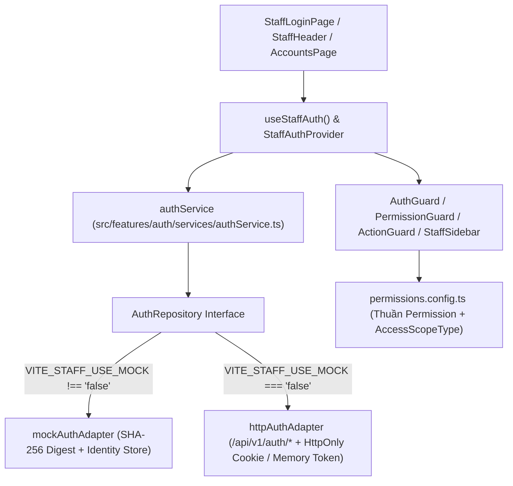

# KIẾN TRÚC XÁC THỰC & PHÂN QUYỀN NHÂN VIÊN – STAFF WEB (`STAFF_AUTH_ARCHITECTURE`)

## 1. Phạm vi & Định hướng Kiến trúc

Hệ thống xác thực và phân quyền của `apps/staff-web` được thiết kế theo nguyên tắc **Backend-Driven Authentication & Authorization** trong phạm vi **Frontend Only**:

- **Hiện trạng vận hành:** Ứng dụng chạy độc lập với Mock Auth Adapter (`USE_STAFF_MOCK_API = true`), không xây dựng máy chủ Backend Node.js, không tạo Database và không giả lập ký JWT tại trình duyệt.
- **Sẵn sàng tích hợp Backend:** Toàn bộ Login UI, `StaffAuthProvider`, `AuthGuard`, `PermissionGuard`, `ActionGuard`, `StaffSidebar` và `StaffRouter` giao tiếp duy nhất qua tầng trung gian `authService` -> `AuthRepository`. Khi Backend Node.js hoàn thành, chỉ cần đổi cấu hình môi trường `VITE_STAFF_USE_MOCK=false` để chuyển từ `mockAuthAdapter` sang `httpAuthAdapter` mà không cần sửa bất kỳ Component giao diện nào.

---

## 2. Sơ đồ Phân lớp (`Layered Auth Architecture`)

### Các tệp thành phần cốt lõi
1. **Contracts dùng chung (`packages/contracts`):**
   - [`authSession.types.ts`](file:///d:/Web/english-center-mini/packages/contracts/src/auth/authSession.types.ts): Định nghĩa `StaffUserAccountDto`, `StaffEmployeeProfileDto`, `UserRoleAssignmentDto`, `AuthenticatedStaffSessionDto`, `StaffLoginOutcomeDto`, `AccountPermissionAuditLogDto`.
   - [`rbac.types.ts`](file:///d:/Web/english-center-mini/packages/contracts/src/auth/rbac.types.ts): Danh mục chuẩn `STAFF_ROLES` (7 vai trò) và `PERMISSION_CODES` (92+ mã quyền `resource.action`).
2. **Auth Adapters & Token Manager (`apps/staff-web/src/features/auth/`):**
   - [`authRepository.ts`](file:///d:/Web/english-center-mini/apps/staff-web/src/features/auth/repositories/authRepository.ts): Hợp đồng `login`, `completeFirstLoginPassword`, `getMe`, `logout`, `refreshSession`.
   - [`mockAuthAdapter.ts`](file:///d:/Web/english-center-mini/apps/staff-web/src/features/auth/repositories/mockAuthAdapter.ts): Xác thực định danh (`username` hoặc `email`), đối chiếu hàm băm một chiều SHA-256, kiểm tra 5 trạng thái vòng đời tài khoản và tổng hợp phiên `/auth/me`.
   - [`httpAuthAdapter.ts`](file:///d:/Web/english-center-mini/apps/staff-web/src/features/auth/repositories/httpAuthAdapter.ts): Kết nối REST `/api/v1/auth/login`, `/api/v1/auth/me`, `/api/v1/auth/logout`, `/api/v1/auth/refresh` với `credentials: 'include'`.
   - [`sessionTokenManager.ts`](file:///d:/Web/english-center-mini/apps/staff-web/src/features/auth/services/sessionTokenManager.ts): Chỉ giữ `accessToken` trong bộ nhớ RAM (nếu Backend trả Bearer token), ưu tiên `HttpOnly Secure Cookie` do Backend quản lý; tuyệt đối không lưu JWT nhạy cảm hay mật khẩu vào `localStorage`.

---

## 3. Luồng Xác thực & Khởi tạo Quyền Sau Đăng nhập

1. **Bước 1 – Gửi thông tin đăng nhập (`/login`):**
   - Nhân viên nhập `identifier` (`username` hoặc `email`) và `password`.
   - Trước khi tạo phiên mới, `StaffAuthProvider` gọi `staffQueryClient.clear()` để xóa toàn bộ dữ liệu cache của tài khoản trước đó.
2. **Bước 2 – Kiểm tra trạng thái tài khoản:**
   - Sai thông tin xác thực -> Trả `401` với thông báo chung: *"Tên đăng nhập hoặc mật khẩu không chính xác."* (chống dò tài khoản tồn tại).
   - `LOCKED` hoặc `DISABLED` -> Trả `403`: *"Tài khoản của bạn hiện không được phép truy cập. Vui lòng liên hệ quản trị viên."*
   - `PENDING_ACTIVATION` -> Trả `403`: Thông báo tài khoản đang chờ kích hoạt.
   - `PASSWORD_RESET_REQUIRED` -> Trả kết quả `outcome: 'PASSWORD_RESET_REQUIRED'`, chuyển ngay sang biểu mẫu **Đổi mật khẩu bắt buộc lần đầu** trước khi cấp phiên làm việc.
3. **Bước 3 – Nạp phiên quyền `/api/v1/auth/me`:**
   - Nhận `AuthenticatedStaffSessionDto` gồm `user`, `employee`, `roles`, `permissions`, `scopes`, `defaultLandingRoute`.
   - Nếu `permissions.length === 0`, điều hướng về `/no-access` (*"Tài khoản chưa được cấp quyền truy cập hệ thống."*).
   - Nếu có quyền hợp lệ, `resolveStaffDefaultHomePath(session)` kiểm tra `defaultLandingRoute` có đủ quyền không; nếu không thì chọn route đầu tiên hợp lệ theo `permissions`.
4. **Bước 4 – Đồng bộ & Thu hồi Phiên Tức thì:**
   - Khi tài khoản đang mở bị khóa (`LOCKED` / `DISABLED`) hoặc được cập nhật quyền, sự kiện `STAFF_AUTH_SYNC_EVENT` kích hoạt nạp lại `getMe()`. Nếu bị khóa hoặc nhận `HTTP 401`, phiên bị hủy ngay và chuyển về `/login?reason=session_expired`.
   - Khi gặp `HTTP 403` (thiếu quyền chức năng), ứng dụng giữ nguyên phiên đăng nhập và hiển thị trang `403 – Forbidden`.

---

## 4. Nguyên tắc Bảo mật Thực thi ở Frontend

- **Không mật khẩu dùng chung:** Đã loại bỏ hoàn toàn mật khẩu mẫu dùng chung cũ. Mỗi tài khoản Demo trong môi trường DEV sử dụng mật khẩu riêng biệt, được kiểm chứng qua băm một chiều SHA-256 (`hashMockCredential`).
- **Không lưu mật khẩu văn bản thuần:** Mật khẩu không bao giờ xuất hiện trong `StaffUserAccountDto`, `localStorage`, `sessionStorage`, query string hay `console.log`.
- **Frontend Guard chỉ phục vụ UX:** Tài liệu và mã nguồn khẳng định rõ việc ẩn/hiện menu hay chặn route ở React chỉ là lớp giao diện; khi triển khai Backend Node.js, mọi API bắt buộc kiểm tra lại Authentication, Permission và Access Scope tại tầng Server.
