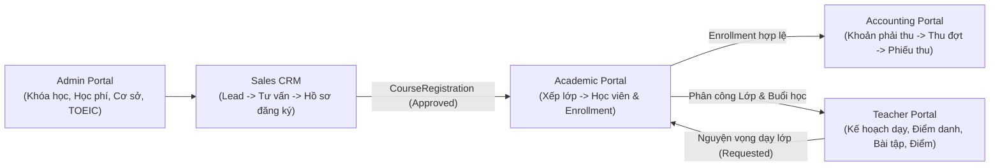

# BÁO CÁO TÍCH HỢP LIÊN THÔNG TOÀN HỆ THỐNG STAFF WEB (`STAFF_INTEGRATION_REPORT`)

## 1. Tổng quan Kiến trúc Liên thông 5 Phân hệ

Trong cùng một ứng dụng `apps/staff-web/` (`http://localhost:5174`), 5 phân hệ vai trò vận hành trên một kiến trúc chia sẻ hợp đồng dữ liệu (`@english-center/contracts`) và kho lưu trữ phiên thống nhất mà không tạo nguồn dữ liệu trùng lặp:

---

## 2. Đối chiếu Ranh giới Nghiệp vụ Giữa Các Phòng ban

| Bộ phận | Quyền hạn thực thi | Hạng mục bị chặn đúng đặc tả |
| :--- | :--- | :--- |
| **Admin (`ADMIN`)** | Cấu hình danh mục khóa học, chính sách học phí, CMS, kho đề TOEIC; giám sát đọc các phân hệ & duyệt hoàn tiền / hồ sơ khi cần. | Không mặc định làm thay thao tác thu ngân, xếp lớp hàng ngày hay điểm danh lớp học của Giảng viên. |
| **Sale (`SALES`)** | Quản lý Lead thuộc phạm vi `own`, tư vấn, lập và nộp hồ sơ đăng ký gắn lớp mở. | Không thu tiền, không tạo Học viên chính thức hay `Enrollment`. |
| **Kế toán (`ACCOUNTANT`)** | Lập khoản phải thu từ `Enrollment`, thu tiền mặt/chuyển khoản thủ công từng đợt, xuất phiếu thu, hoàn tiền, hủy giao dịch sai (`Void`). | Không sửa lớp học, không sửa điểm danh hay điểm thi; không xóa cứng giao dịch. |
| **Giáo vụ (`ACADEMIC` / `HR_ACADEMIC`)** | Duyệt hồ sơ Sale, xếp lớp theo tháng, mở/sửa lớp dùng chung, chuyển lớp giữ lịch sử, xử lý bảo lưu/học lại, duyệt nguyện vọng dạy của GV, quản lý phiên bản Syllabus. | Không thu học phí, không tự tính công thức hoàn tiền, không sửa điểm thi của Giảng viên, không ghi đè khóa học công khai Website. |
| **Giảng viên (`TEACHER`)** | Soạn kế hoạch buổi dạy, điểm danh 3 trạng thái, giao/chấm bài tập, nhập điểm kiểm tra, theo dõi tiến độ các lớp thuộc `assigned_classes_only`; gửi nguyện vọng nhận lớp trống. | Bị chặn `403` khi mở lớp của giảng viên khác; không sửa giờ/phòng chính thức; không tự phân công mình vào lớp mới; không xem học phí. |

---

## 3. Tài khoản Kiểm thử Nhanh trên `/login` (Mật khẩu chung: `Staff@2026`)

| Vai trò | Email đăng nhập | Trang chủ mặc định | Đặc điểm kiểm thử nổi bật |
| :--- | :--- | :--- | :--- |
| **Admin** | `admin@englishcenter.edu.vn` | `/dashboard` | Giám sát toàn diện + cấu hình hệ thống |
| **Sale 1** | `sales@englishcenter.edu.vn` | `/sales/dashboard` | Phạm vi `own` (Lê Thanh Thảo) |
| **Sale 2** | `sales2@englishcenter.edu.vn` | `/sales/dashboard` | Phạm vi `own` (Hoàng Gia Bảo) |
| **Kế toán** | `accountant@englishcenter.edu.vn` | `/accounting/dashboard` | 6 mục menu Kế toán hoàn chỉnh |
| **Giáo vụ** | `academic@englishcenter.edu.vn` | `/academic/dashboard` | 6 mục menu Giáo vụ + xét duyệt hồ sơ Sale |
| **NS – Giáo vụ** | `hr-academic@englishcenter.edu.vn` | `/academic/dashboard` | Giáo vụ + Quản lý tin tuyển dụng |
| **Giảng viên 1** | `teacher@englishcenter.edu.vn` | `/teacher/dashboard` | Cô Lan Hương (`EC-S01`, `ONL-SB01`...) |
| **Giảng viên 2** | `thay.duc.minh@englishcenter.edu.vn` | `/teacher/dashboard` | Thầy Đức Minh (`TOEIC-FD01`, `ONL-FD01`...) |

---

## 4. Xác minh Kỹ thuật Toàn Dự án

1. **Bảo toàn tuyệt đối `apps/client-web`**: `0` tệp tin bị chỉnh sửa trên `apps/client-web`; `npm run build:client` thành công trong `3.62s`.
2. **Không cài thêm bất kỳ thư viện npm mới nào**: Toàn bộ biểu đồ tài chính được vẽ bằng `<svg>` thuần (`SvgCharts.tsx`), in phiếu thu sử dụng chuẩn trình duyệt `window.print()`.
3. **Kiểm tra tĩnh nghiêm ngặt**:
   - `npm run typecheck`: `0` lỗi TypeScript trên toàn bộ 4 shared packages và 2 apps.
   - `npm run lint`: `0` cảnh báo, `0` lỗi trên tổng cộng `333` tệp nguồn (`22` packages + `181` client-web + `130` staff-web).
   - `npm run build:staff`: Build production thành công trong `3.52s`.
