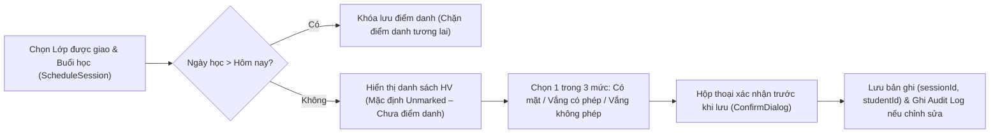

# QUY TRÌNH NGHIỆP VỤ PHÂN HỆ GIẢNG VIÊN (`TEACHER_WORKFLOW`)

## 1. Luồng Điểm danh Buổi học Chuẩn 3 Trạng thái

## 2. Luồng Giao & Chấm Bài tập Lớp học

1. Giảng viên tạo bài tập gắn với lớp phụ trách và buổi học cụ thể, chọn đối tượng nhận bài (`Toàn lớp` / `Nhóm học tập` / `Học viên kèm riêng`).
2. Hệ thống tự khởi tạo danh sách theo dõi nộp bài (`NotSubmitted`) cho đúng học viên mục tiêu.
3. Khi học viên nộp bài (`Submitted` hoặc `LateSubmitted`), Giảng viên mở link bài làm, chấm điểm trong khoảng `[0, maxScore]` kèm nhận xét (`Graded`) hoặc bấm **Yêu cầu nộp lại (`ReturnedForRevision`)**.

## 3. Luồng Nhập Điểm Kiểm tra & Theo dõi Tiến độ

- Nhập điểm Listening (`0–495`) và Reading (`0–495`), hoặc bỏ chọn đánh giá để lưu `null` (`Chưa đánh giá`) khi học viên chờ thi bù.
- Mọi chỉnh sửa trên bản ghi điểm đã có đều lưu vào `GradeAuditEntryDto`.
- Bảng **Tiến độ học tập** tự động tính toán từ dữ liệu thực và kích hoạt nhãn **Cần hỗ trợ** theo 4 tiêu chí định lượng minh bạch:
  1. `Chuyên cần < 80%`
  2. `Vắng không phép >= 2 buổi`
  3. `Hoàn thành bài tập < 70%`
  4. `Điểm Giữa khóa < Điểm đầu vào`

## 4. Luồng Đăng ký Nguyện vọng Dạy lớp mới

- Tại `/teacher/schedule` → tab **Lớp đang cần giảng viên**, hệ thống tự động đối chiếu ca học của lớp trống với các lớp hiện tại của Giảng viên.
- Nếu không trùng ca, Giảng viên gửi nguyện vọng (`Requested`) để Giáo vụ xét duyệt tại `/academic/classes`.
