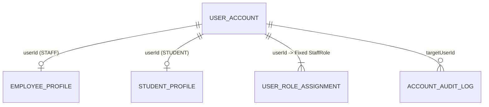

# MÔ HÌNH DỮ LIỆU TÀI KHOẢN, HỒ SƠ & VAI TRÒ (`ACCOUNT_MODEL`)

Nguồn chuẩn dùng chung hai ứng dụng: [`packages/contracts/src/auth/rbac.types.ts`](file:///d:/Web/english-center-mini/packages/contracts/src/auth/rbac.types.ts) và [`packages/contracts/src/auth/authSession.types.ts`](file:///d:/Web/english-center-mini/packages/contracts/src/auth/authSession.types.ts).

---

## 1. Phân loại Tài khoản & Ứng dụng (`AccountType` & `PortalType`)

```ts
export type AccountType = 'STUDENT' | 'STAFF'
export type PortalType = 'CLIENT' | 'STAFF'

export type StudentRole = 'STUDENT'
export type StaffRole = 'ADMIN' | 'SALES' | 'ACCOUNTANT' | 'ACADEMIC' | 'TEACHER'
```

- **Quy tắc bất biến:** Người dùng không bao giờ tự gửi `accountType`, `portal` hay `role` khi đăng nhập. Định danh tài khoản được xác thực xong mới suy ra `AccountType` -> `PortalType` -> `Role`.

---

## 2. Tách biệt Thực thể Tài khoản Đăng nhập và Hồ sơ Nhân viên



### 2.1. `StaffUserAccountDto` (`UserAccount`)
Đại diện duy nhất cho thông tin đăng nhập và vòng đời truy cập:
- `id`: Mã định danh bất biến.
- `username`: Định danh đăng nhập duy nhất (`3–32` ký tự `[a-z0-9._-]`).
- `email`: Email đăng nhập duy nhất.
- `accountType`: `'STAFF' | 'STUDENT'`.
- `status`: `'PENDING_ACTIVATION' | 'ACTIVE' | 'LOCKED' | 'DISABLED' | 'PASSWORD_RESET_REQUIRED'`.
- `provisioningMethod`: `'INVITE_LINK' | 'TEMPORARY_PASSWORD'`.
- `mustChangePassword`: Cờ bắt buộc đổi mật khẩu lần đầu.
- `lastLoginAt`, `createdAt`, `updatedAt`.
- **Bảo mật:** Không chứa trường `password` hay `passwordHash`.

### 2.2. `StaffEmployeeProfileDto` (`EmployeeProfile`)
Đại diện cho hồ sơ nghiệp vụ nhân sự / giảng viên:
- `id`, `userId` (khóa ngoại trỏ sang `UserAccount.id`).
- `employeeCode`: Mã nhân viên / mã giảng viên duy nhất (`NV-SAL-01`, `GV-TOEIC-01`...).
- `fullName`, `phone` (chuẩn hóa 10 số VN), `email`.
- `profileType`: `'EMPLOYEE' | 'TEACHER'`.
- `branchId`, `branchName`: Tham chiếu danh mục Cơ sở thực tế.
- `departmentId`, `departmentName`: Tham chiếu danh mục Phòng ban chuẩn.
- `jobTitle`: Chức danh công việc.
- `status`: `'ACTIVE' | 'INACTIVE'` *(trạng thái công tác nhân sự, tách biệt hoàn toàn với `UserAccount.status`)*.
- Mở rộng khi `profileType === 'TEACHER'`: `verifiedToeicScore`, `specializations`, `assignedClassCodes`.

### 2.3. `UserRoleAssignmentDto`
Gắn tài khoản nhân sự với **Role Template cố định** và **Phạm vi dữ liệu (`AccessScopeType`)**:
- `userId`, `roleId` (`StaffRole`), `scopeType` (`'OWN' | 'TEAM' | 'BRANCH' | 'ALL'`), `scopeIds` (danh sách `branchId` khi `BRANCH`), `assignedByUserId`, `assignedAt`.
