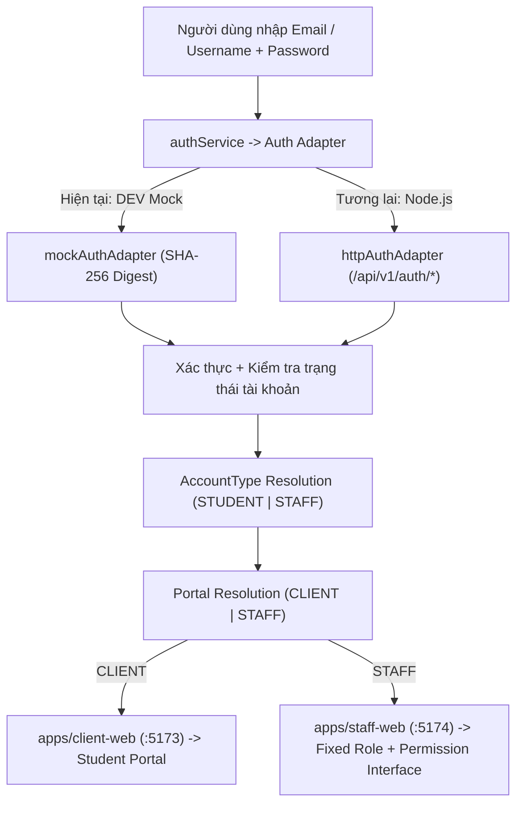

# KIẾN TRÚC XÁC THỰC & PHÂN QUYỀN CỐ ĐỊNH (`AUTH_ARCHITECTURE`)

## 1. Mô hình Kiến trúc Tổng thể

Hệ thống **English Center** vận hành theo mô hình:

**MỘT HỆ THỐNG TÀI KHOẢN – HAI FRONTEND ĐỘC LẬP – MỘT BACKEND DÙNG CHUNG (DỰ KIẾN) – ROLE/PERMISSION CỐ ĐỊNH**



---

## 2. Phân định Trách nhiệm Minh bạch

| Hạng mục | Trạng thái hiện tại | Nơi chịu trách nhiệm |
| :--- | :---: | :--- |
| Giao diện Đăng nhập (`AuthPage`, `StaffLoginPage`) | **Đã triển khai** | Frontend (`client-web` & `staff-web`) – Không có dropdown chọn Role hay Portal |
| `Fixed Role & Permission Registry` | **Đã triển khai** | Định nghĩa cố định tại [`permissions.config.ts`](file:///d:/Web/english-center-mini/apps/staff-web/src/services/permissions/permissions.config.ts), Admin không thể chỉnh sửa |
| `PortalResolver` & Allowlist URL | **Đã triển khai** | [`staff-web/.../portalResolver.ts`](file:///d:/Web/english-center-mini/apps/staff-web/src/services/portal/portalResolver.ts) & [`client-web/.../portalResolver.ts`](file:///d:/Web/english-center-mini/apps/client-web/src/services/portal/portalResolver.ts) |
| Xác thực mật khẩu & cấp phiên hiện tại | **Mock (Development)** | `mockAuthAdapter` dùng băm một chiều `SHA-256` với mật khẩu riêng từng tài khoản mẫu |
| `httpAuthAdapter` (`/api/v1/auth/*`) | **Đã chuẩn bị Adapter (Chưa có Backend)** | [`httpAuthAdapter.ts`](file:///d:/Web/english-center-mini/apps/staff-web/src/features/auth/adapters/httpAuthAdapter.ts) |
| Băm mật khẩu `Argon2id/bcrypt`, ký Session/Cookie, kiểm tra Scope trên SQL | **Cần Backend triển khai** | Máy chủ Backend Node.js (Chưa triển khai trong phạm vi nhiệm vụ này) |

---

## 3. Cấu trúc Thư mục Auth trên `apps/staff-web`

```text
apps/staff-web/src/features/auth/
├── adapters/
│   ├── mockAuthAdapter.ts      # Xác thực Mock SHA-256, kiểm tra trạng thái & Portal
│   └── httpAuthAdapter.ts      # Chuẩn bị gọi /api/v1/auth/login, /me, /logout, /refresh
├── context/
│   ├── StaffAuthProvider.tsx   # Quản lý phiên, xóa Query Cache khi đổi tài khoản / 401
│   └── staffAuthContextInstance.ts
├── hooks/
│   └── useStaffAuth.ts
├── mocks/
│   └── staffIdentityMockStore.ts
├── pages/
│   └── StaffLoginPage.tsx
├── repositories/
│   └── authRepository.ts
├── services/
│   ├── authService.ts
│   └── sessionTokenManager.ts
├── types/
│   └── staffAuth.types.ts
└── index.ts
```

---

## 4. Xử lý Session, Đăng xuất & Đổi Tài khoản

1. **Tách biệt hoàn toàn giữa hai Frontend:** `client-web` và `staff-web` chạy trên hai origin riêng, sử dụng hai `QueryClient` và hai khóa phiên riêng, không chia sẻ React Context.
2. **Khi Logout hoặc chuyển từ tài khoản A sang B:**
   - Gọi `logout()` trên Adapter.
   - Xóa sạch Token trong RAM (`sessionTokenManager.clear()`) và khóa phiên Mock.
   - Gọi `queryClient.clear()` để xóa toàn bộ dữ liệu riêng tư của tài khoản A trước khi nhận phiên của tài khoản B.
3. **Không dùng `localStorage` cho Refresh Token dài hạn:** `httpClient` đã cấu hình `credentials: 'include'` để sẵn sàng dùng `HttpOnly Secure Cookie` khi thống nhất với Backend Developer.
